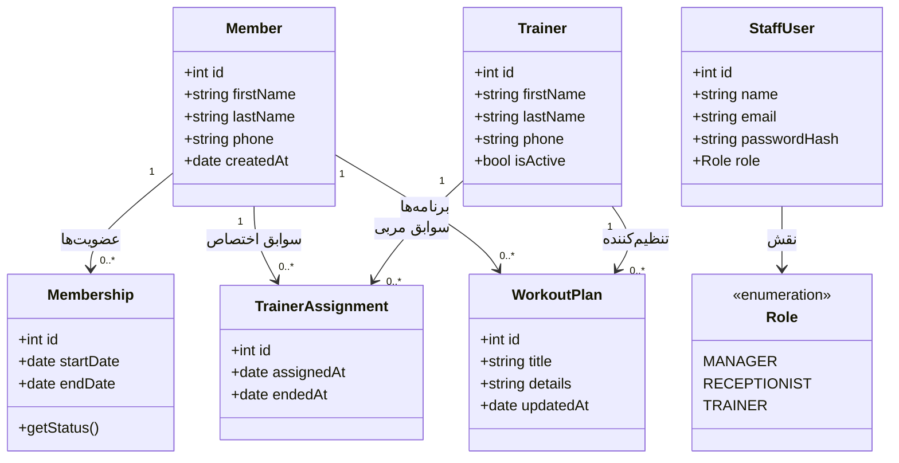

# نمودار کلاس‌ها — سیستم مدیریت باشگاه ورزشی

## ۱. هدف

این نمودار کلاس‌های مفهومی اصلی سیستم مدیریت باشگاه و ارتباط میان آن‌ها را نشان می‌دهد. این نمودار، مدل طراحی پیشنهادی است و هنوز به معنی پیاده‌سازی کد نیست.

## ۲. Class Diagram

## ۳. توضیح کلاس‌ها

| کلاس | مسئولیت |
|---|---|
| Member | نگهداری اطلاعات اعضای باشگاه |
| Trainer | نگهداری اطلاعات مربیان |
| Membership | نگهداری بازه‌ی زمانی عضویت |
| TrainerAssignment | ثبت ارتباط عضو با مربی |
| WorkoutPlan | نگهداری برنامه‌ی تمرینی عضو |
| StaffUser | نگهداری حساب کارکنان مجاز به ورود به سیستم |
| Role | تعیین نقش و نوع دسترسی کارکنان |

## ۴. روابط اصلی

- هر عضو می‌تواند چند دوره‌ی عضویت داشته باشد.
- هر عضو می‌تواند سابقه‌ی اختصاص مربی داشته باشد.
- هر مربی می‌تواند به چند عضو اختصاص داده شود.
- هر عضو می‌تواند برنامه‌های تمرینی مختلفی داشته باشد.
- هر برنامه‌ی تمرینی به یک عضو و مربی تنظیم‌کننده مرتبط است.
- حساب کاربری کارکنان از اطلاعات اعضای باشگاه جداست؛ عضو در محدوده‌ی فعلی حساب کاربری مستقیم ندارد.

## ۵. تصمیم‌های نیازمند تأیید

- آیا تمدید عضویت به‌صورت ایجاد دوره‌ی جدید ثبت می‌شود یا ویرایش دوره‌ی قبلی؟
- آیا عضو در یک زمان فقط یک مربی فعال دارد؟
- آیا هر مربی باید حساب ورود مستقل داشته باشد؟
- فیلدهای نهایی هر کلاس پس از تأیید طرح دیتابیس مشخص می‌شوند.

## ۶. ارتباط با نیازمندی‌ها

این نمودار به‌طور کلی از User Storyهای US-01 تا US-11 استخراج شده است. در صورت تغییر نیازمندی‌ها، نمودار نیز باید به‌روز شود.
