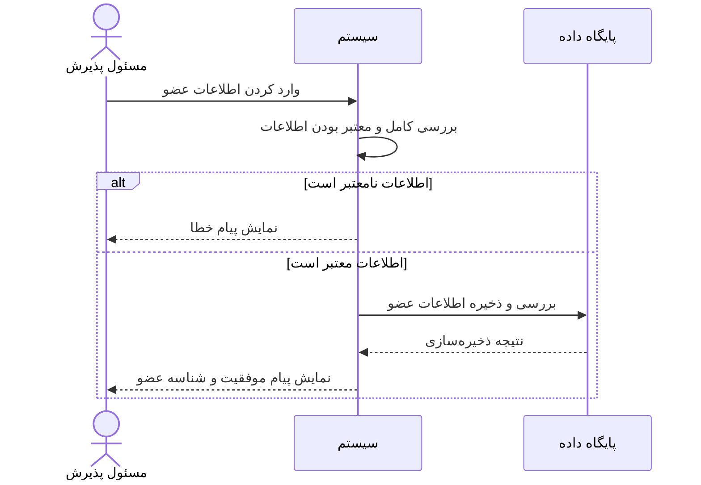
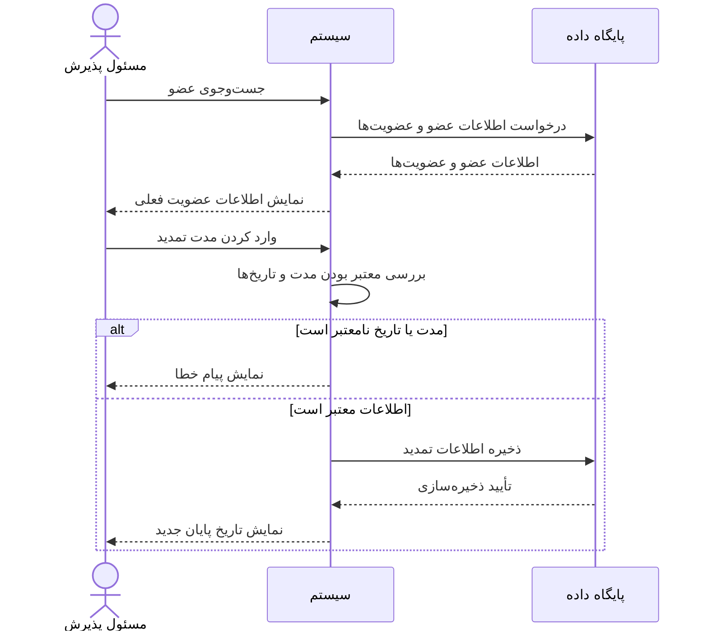
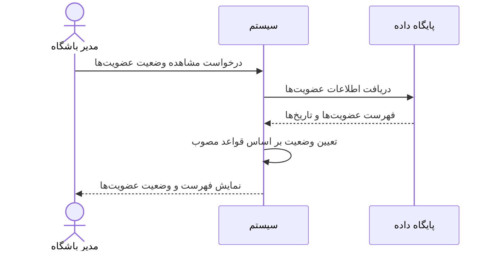

# نمودار توالی — سیستم مدیریت باشگاه ورزشی

## ۱. هدف

این سند ترتیب تعاملات بازیگرها با سیستم را در سناریوهای اصلی نشان می‌دهد. نمودارها بر اساس User Storyهای فعلی تهیه شده‌اند و مستقل از فناوری پیاده‌سازی هستند.

## ۲. سناریو اول: ثبت عضو جدید (US-01)

## ۳. سناریو دوم: تمدید عضویت (US-06)

## ۴. سناریو سوم: مشاهده‌ی وضعیت عضویت‌ها (US-07)

## ۵. خطاهای قابل بررسی

| وضعیت | رفتار مورد انتظار |
|---|---|
| اطلاعات ضروری ناقص است | نمایش خطا و جلوگیری از ذخیره |
| عضو پیدا نمی‌شود | نمایش پیام «عضوی یافت نشد» |
| مدت تمدید معتبر نیست | نمایش خطا و عدم تغییر اطلاعات |
| ذخیره‌سازی با شکست مواجه می‌شود | نمایش پیام مناسب و جلوگیری از اعلام موفقیت |

## ۶. نکات

- این نمودارها توصیف رفتاری سیستم هستند و کد اجرایی محسوب نمی‌شوند.
- جزئیات پایگاه داده و رابط برنامه‌نویسی پس از تأیید معماری فنی تکمیل می‌شوند.
- هر تغییر در User Storyها باید در نمودارهای مرتبط نیز منعکس شود.
